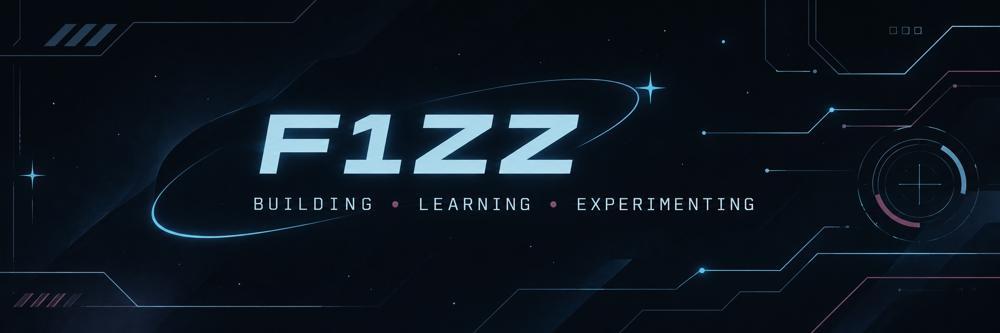
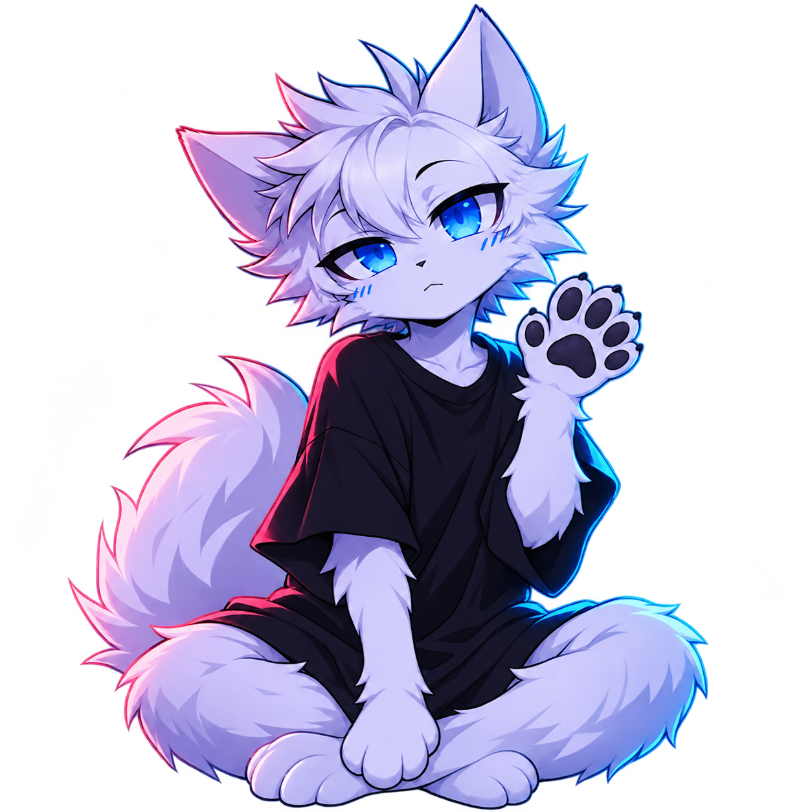

 

*Developer · Automation Enthusiast · Future Cybersecurity Specialist*

---

<h2 align="center">✦ ABOUT ME ✦</h2>

  Hey! I'm F1zz.

  I'm a software development student interested in programming, automation, artificial intelligence and cybersecurity.

  I enjoy experimenting with different technologies, building personal projects and turning ideas into working applications.

  Currently learning, improving my skills and exploring new possibilities in software development.

  <em>One idea. One project. One step forward.</em>

---

<h2 align="center">✦ CURRENT FOCUS ✦</h2>

<table align="center">
<tr>
<td width="50%" valign="top">

<h3 align="center">⌨ Backend Development</h3>

Working with Python, APIs, application logic and backend technologies.

</td>
<td width="50%" valign="top">

<h3 align="center">🤖 AI & Automation</h3>

Experimenting with AI integrations, Telegram bots and desktop automation.

</td>
</tr>
<tr>
<td width="50%" valign="top">

<h3 align="center">📱 App Development</h3>

Exploring Kotlin, Android development and application architecture.

</td>
<td width="50%" valign="top">

<h3 align="center">🛡 Cybersecurity</h3>

Learning about information security, systems and cybersecurity fundamentals.

</td>
</tr>
</table>

---

<h2 align="center">✦ TECHNOLOGIES ✦</h2>

  

  

  Always exploring something new.

---

<h2 align="center">✦ FEATURED PROJECT ✦</h2>

<table align="center">
<tr>
<td width="100%">

<h3 align="center">🤖 JARVIS — Personal AI Assistant</h3>

A personal AI assistant inspired by the concept of an intelligent digital companion.

**Planned and developing features:**

- AI-powered conversations using language models.
- Telegram bot integration.
- PC control and desktop automation.
- Interaction with the operating system.
- Remote access to selected computer functions.

**Technologies:**

`Python` `Telegram API` `Groq API` `PyAutoGUI` `AI`

  <em>Building my own digital assistant, one feature at a time.</em>

  <!-- Add your JARVIS repository URL when available -->
  

</td>
</tr>
</table>

---

<h2 align="center">✦ GITHUB OVERVIEW ✦</h2>

  
  

  

  

---

### Thanks for visiting!

*Keep learning. Keep building. Stay curious.*

**F1zz © 2026**

